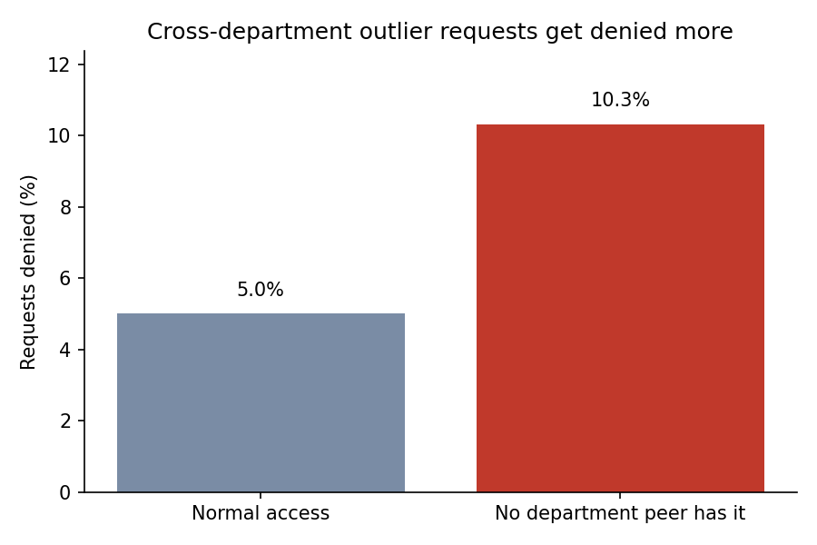
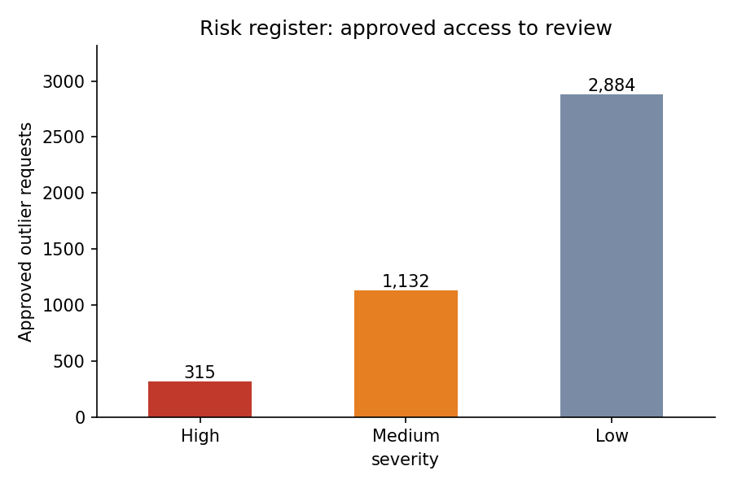
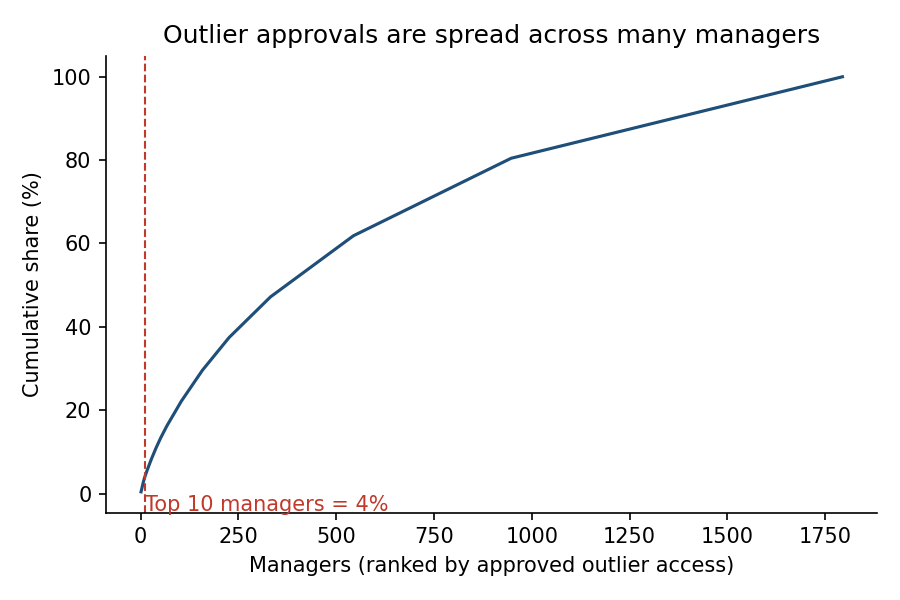

# Access Governance Anomaly Analytics

Which access approvals should a reviewer look at first? This project profiles **32,769 real
employee access requests** and flags access that doesn't fit the requester's peer group, then
ranks the approved cases into a risk register.

**Tools:** Python (Pandas, Matplotlib), SQL (SQLite)
**Data:** [Amazon Employee Access](https://www.openml.org/d/4135) (public, OpenML id 4135).
Each row is one request: the resource asked for, the employee's manager, department, job
title and role hierarchy, and whether access was **approved or denied**. All IDs are anonymised.

---

## Key findings

| | |
|---|---|
| Requests analysed | **32,769** across 7,518 resources, 4,243 managers, 343 job titles |
| Overall approval rate | **94.2%** |
| Peer-group outliers found | **4,829 requests (14.7%)** |
| Denial rate: outliers vs normal | **10.3% vs 5.0%** (**2.06×**) |
| Approved outliers in the risk register | **4,331**: 315 High, 1,132 Medium, 2,884 Low |

### 1. "Nobody in my department has this" is a real risk signal
A request is a **peer-group outlier** when *no one else in the same department* has requested
that resource, even though it's used **5+ times by other departments**.

Those requests are denied **2.06× as often** as normal ones (10.3% vs 5.0%). Approvers already
treat this access as unusual, but **4,331 of these requests were still approved**, which makes
them the natural starting point for an access review.



### 2. A ranked risk register, not a flat list
Each approved outlier gets a 0–1 risk score from three signals:

| Signal | Weight | Meaning |
|---|---|---|
| Use elsewhere | 50% | How widely other departments use it (common elsewhere, absent here) |
| Resource denial history | 30% | How often that resource is denied to other people |
| Manager pattern | 20% | How many outlier approvals the same manager has signed off |

Scores are bucketed into **315 High, 1,132 Medium and 2,884 Low**, so a reviewer can start with
315 cases instead of 4,331. The full list is in `outputs/04_risk_register.csv`.



### 3. No single manager is the problem
Outlier approvals are spread across **1,794 managers**. The top 10 account for only **3.8%**, so
this calls for a process-level review (e.g. peer-group checks at approval time), not targeting
a few approvers.



### 4. Data quality checks
- **0 nulls, 0 duplicate rows** across all 10 columns.
- **3,766 resources were requested only once**. That long tail is why a simple "rare resource" rule
  fails: a "<5% of the job title's requests" rule flagged 93% of all requests, so it was replaced
  with the department rule above.
- `ROLE_TITLE` and `ROLE_CODE` map **1-to-1**, so one is redundant for analysis.
- **Department 118992** has the lowest approval rate (62.6% over 206 requests).

---

## How it works

1. **Load and profile**: shape, dtypes, nulls, duplicates, distinct values per column.
2. **Data quality**: redundancy check (title vs code), long-tail resources.
3. **Peer-group analysis**: count, for each request, how many others in the same department asked
   for that resource and how often it's used elsewhere.
4. **Risk register**: score and rank approved outliers into High / Medium / Low.
5. **SQL cross-check**: `queries.sql` reproduces the headline numbers in SQLite
   (results in `outputs/06_sql_results.txt`).
6. **Charts** saved to `images/`.

## Run it
```bash
pip install -r requirements.txt
python analysis.py
```

## Project structure
```
access-governance-analytics/
├── analysis.py        # full pipeline: load, profile, peer groups, risk register, charts
├── queries.sql        # SQL versions of the key checks (run by analysis.py)
├── data/              # Amazon_employee_access.arff (public dataset)
├── outputs/           # profile, data quality, peer-group summary, risk register, SQL results
└── images/            # charts used in this README
```

## Limitations
- The dataset has no account-status or last-login fields, so dormant or orphaned accounts
  can't be checked here. Those would be the next signals to add with real IAM data.
- Risk-score weights are judgement-based, not learned from outcomes.
